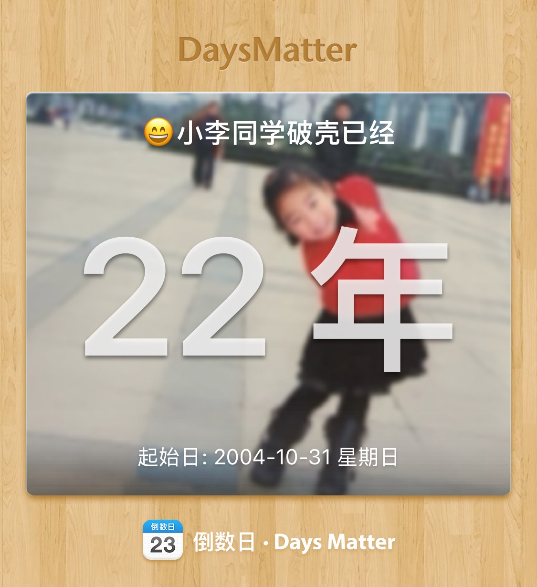
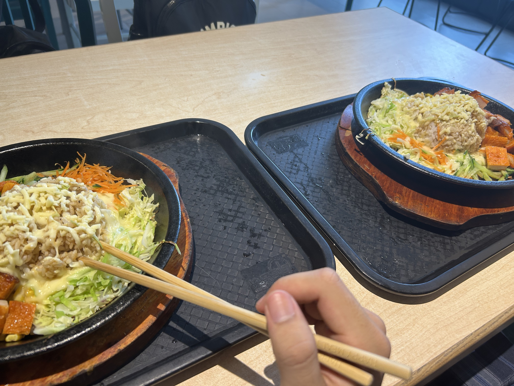
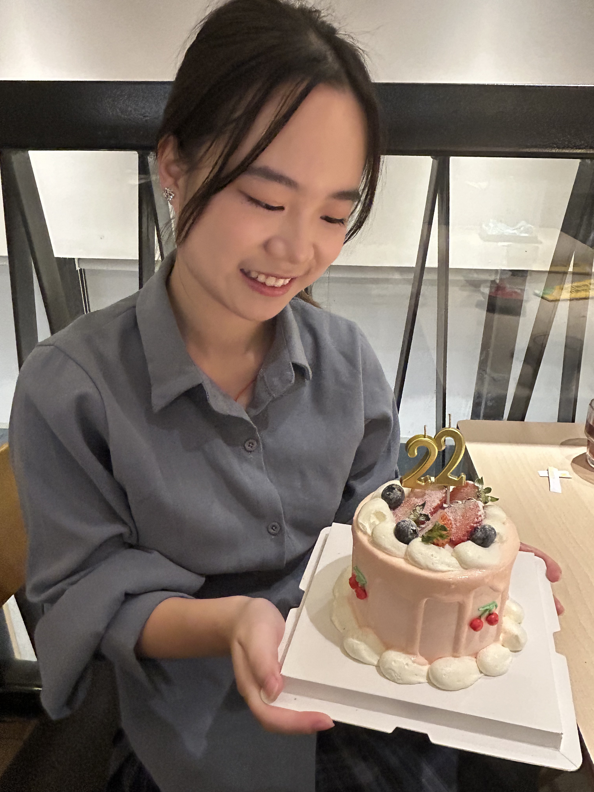
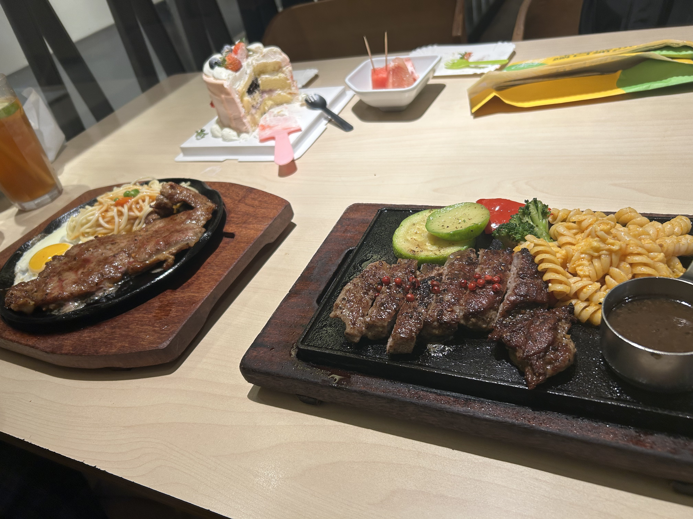
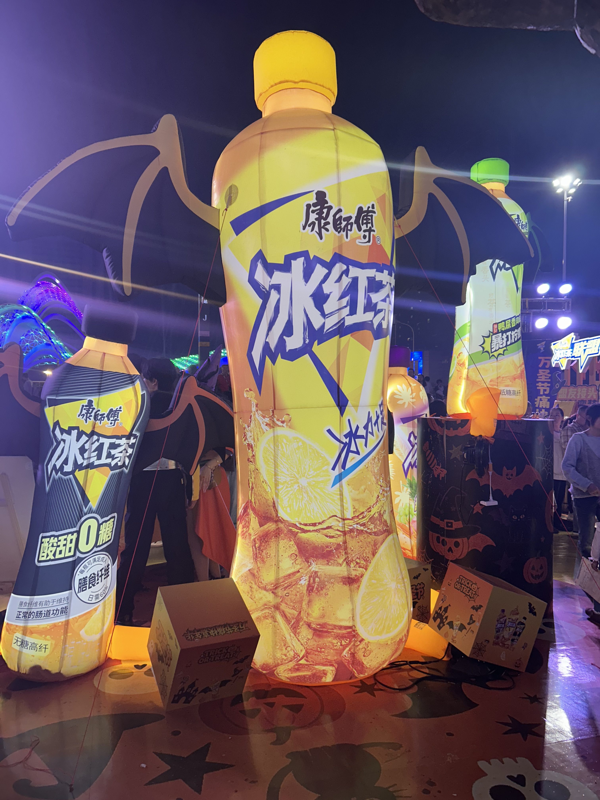
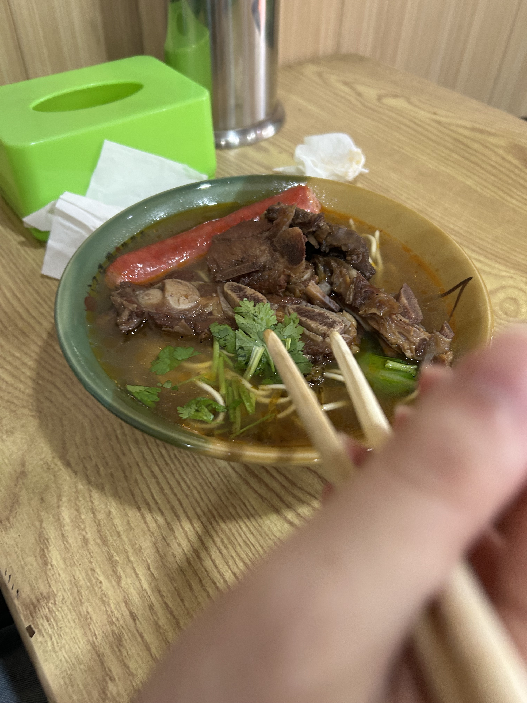

### 今天是小李同学的22岁生日！

今天我早早坐着地铁，赶着中午到了中南财，陪小李一起吃饭。今天中午小李带我吃了她常吃的芝士鸡肉铁板饭，味道非常不错，就是感觉肉排有点硬邦邦的。

吃完饭后，小李就回宿舍睡觉了，我也去教室四楼找了个座位坐下。等到下午两点的时候，小李就醒了，然后我就骑着我的战马赶紧去接她来教室。小李今天真认真，到了教室之后一直在库库写，生日也不休息（虽然前几天小李已经休息过了）。

下午感觉写了很多东西，忙了很久，到了差不多快五点的时候，蛋糕也送到了，小李也搞得差不多了，就回去化妆收拾了。我忙完之后又回到宿舍楼下接小李。小李一个全妆美女站在我的面前\~超级超级美啊，但是那时候蛋糕送来已经有一段时间了，我就有点担心蛋糕有没有化掉，虽然口头上没有马上说小李同志今天如此漂亮（下面看得到美女！）\~但是看到的第一眼已经被小李的美震撼到啦！

拿到蛋糕之后，竟然一点都没化，看来天气确实开始冷了。原本想打车，但是一直都打不到。小李的生日刚好在万圣节，在武汉这样年轻人的大城市，这种节日就会有很多很多Coser上街，所以交通特别特别堵。无奈，只好去坐公交了（依旧很堵）。公交上的小登们还出言不逊，觉得自己985、211手到擒来，结果自己才大二，这一切的未知数可太多了。人还是得脚踏实地，不要天天讲这些虚的，985、211什么的都是头衔，先成为一名真正优秀的人，再去选择提升自己的平台。

今晚的光谷广场真的都是人，有一些Coser，但我没感觉特别多，可能大部分都去黎黄陂路了。看着这么多人，还以为豪客来没座位了，结果好在豪客来二楼很空，不错不错。

菜上齐之前，小李已经迫不及待想吃蛋糕了！

小李端着蛋糕让我给她拍照，拍了好几张对着镜头的，感觉还是这张特别自然好看。蛋糕里面主要是奥利奥碎和芋泥，我感觉挺好吃的，但是确实哦，像小李说的，没有水果确实容易腻。

过了一会，双人套餐来了！小李依旧是果木牛排，太香了。我的是红胡椒牛排，也挺不错的。接着还有很多小食和甜品，超级超级好吃啊！

吃的心满意足，准备返程，路上还遇到了光谷的活动。这个活动是康师傅冰红茶主办的，难绷的是活动的背景音乐是《See you again》，但是为什么没有牢大，真的是差点味道，但是感觉牢大不在也已经在了。

和小李骑车去酒店之后，我们就回房间休息啦\~小李真的太刻苦了，晚上九点十点了还在背政治，十点钟也实在太晚了，不要这么大压力啦\~一切都会变好的，要相信美好的存在。

背着背着就到十一点多了，不早啦，休息咯。小李22岁生日快乐啊~未来你也要天天快乐，一切美好的事都会发生的，快乐永远是自己的，不要让她溜走哦，而且不止21和22岁，未来的每一个生日我都会陪你度过的。

第二天中午吃了牛骨面，特地来这里补充一下，特别好吃。小李吃的都说自己好幸福了，真的很好吃哦。

